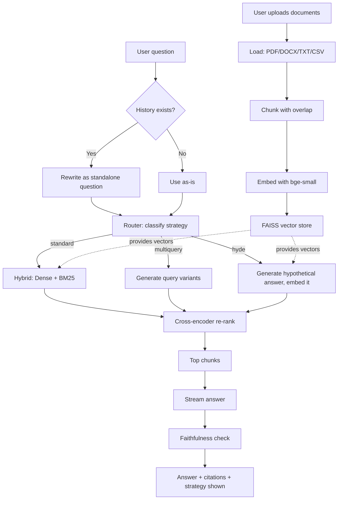
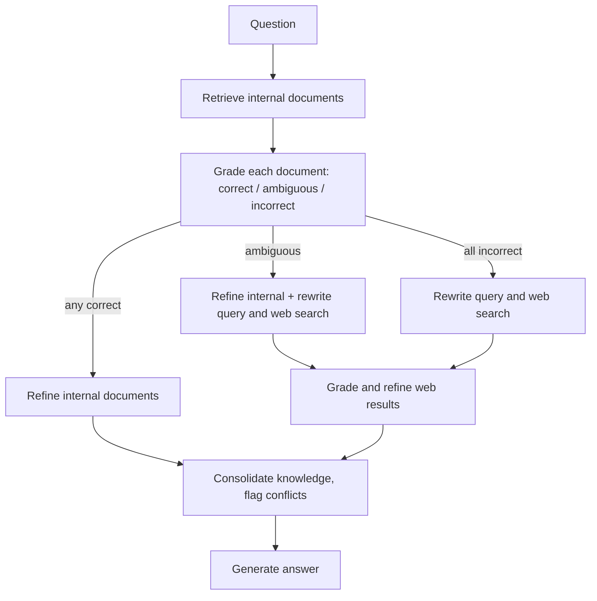
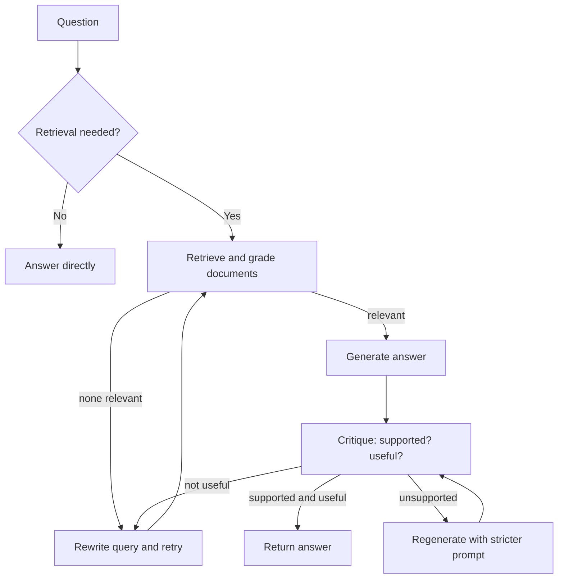

# 📄 Multi-Document RAG Assistant

A retrieval-augmented generation system that lets you upload multiple documents (PDF, DOCX, TXT, CSV) and ask questions across all of them, with streamed answers, cited sources, conversation memory, and automatic hallucination detection.

Built to explore production-style RAG engineering: hybrid retrieval, cross-encoder re-ranking, adaptive strategy routing, and two advanced RAG variants (Corrective RAG and Self-RAG) evaluated against the baseline on a labeled dataset, not just a basic "embed and retrieve" pipeline.

## 🎥 Demo


A question answered across indexed documents, with a streamed answer, page-level source citations, and the retrieval strategy chosen by the router.

## Why this project

Most RAG tutorials stop at "chunk, embed, retrieve, generate." This project goes further:

- **Hybrid retrieval** (dense + BM25), not just vector search
- **Cross-encoder re-ranking** on top of hybrid results
- **MMR (Maximal Marginal Relevance)** to reduce redundant chunks in the retrieved context
- **Adaptive RAG:** an LLM router classifies each question and picks between standard retrieval, multi-query expansion, or HyDE
- **Corrective RAG (CRAG):** grades retrieved documents, refines them, and falls back to web search when internal knowledge is weak
- **Self-RAG:** decides whether retrieval is needed, grades documents, critiques its own answer, and retries (prompt-based reflection)
- **Streaming responses** and **short-term conversation memory** with multiple chats in the sidebar
- **A self-checking faithfulness layer** that flags answers not supported by retrieved context
- **A labeled evaluation set** with a LangSmith and RAGAS evaluation harness

## Architecture

### Baseline pipeline (what the app runs)



### Corrective RAG (CRAG)



Knowledge refinement follows the CRAG idea of decompose, filter, recompose: each document is split into knowledge units, each unit is checked for relevance to the question, and only the relevant units are kept. Source metadata is preserved so answers can cite where facts came from. The grader is an LLM call rather than the small trained retrieval evaluator used in the paper.

### Self-RAG



Retries are capped at two attempts. Implemented with prompt-based reflection (LLM-as-judge) rather than the paper's fine-tuned reflection tokens.

## Features

- **Multi-format ingestion** with content-hash tracking so unchanged files are not re-indexed
- **Streaming answers** that appear as they are generated
- **Short-term memory:** follow-up questions are rewritten into standalone questions using the last few turns
- **Multiple conversations** in the sidebar, with a New chat button
- **Source citations** with file name and page, plus the strategy the router chose
- **Hallucination warning** when the faithfulness check fails

## Tech stack

| Layer | Tool |
|---|---|
| Orchestration | LangChain (LCEL) |
| LLM | Anthropic Claude (model set through the `MODEL_NAME` environment variable) |
| Embeddings | `BAAI/bge-small-en-v1.5` |
| Vector store | FAISS |
| Sparse retrieval | BM25 |
| Re-ranking | `cross-encoder/ms-marco-MiniLM-L-6-v2` |
| Web search (CRAG fallback) | Tavily |
| Evaluation | LangSmith + RAGAS |
| UI | Streamlit |

## Evaluation

Tested against a 13-chapter ML/AI reference document with a hand-labeled set of 16 questions (13 answerable, 3 deliberately outside the document's scope).

### Baseline results (first version of the project)

| Metric | Score | What it measures |
|---|---|---|
| Hit Rate@3 | 100% | Did the correct content appear in the top 3 retrieved chunks? |
| Answer correctness | 92% | Did the generated answer contain the expected key facts? |
| Faithfulness rate | 85% | Did the answer avoid adding unsupported claims? |
| Refusal accuracy | 100% | Did the system correctly say "I don't know" on out-of-scope questions? |

These numbers were measured on the original baseline, before the LLM provider changed and before CRAG and Self-RAG were added.

### Baseline vs CRAG vs Self-RAG (LangSmith + RAGAS)

The same 16 questions run through all three pipelines, scored with the same RAGAS metrics:

| Metric | Baseline | CRAG | Self-RAG |
|---|---|---|---|
| Faithfulness | _to be added_ | _to be added_ | _to be added_ |
| Answer relevancy | _to be added_ | _to be added_ | _to be added_ |
| Factual correctness | _to be added_ | _to be added_ | _to be added_ |
| Context precision | _to be added_ | _to be added_ | _to be added_ |
| Context recall | _to be added_ | _to be added_ | _to be added_ |
| Correct abstention (3 unanswerable questions) | _to be added_ | _to be added_ | _to be added_ |
| LLM calls per question | _to be added_ | _to be added_ | _to be added_ |

Retrieval and generation are evaluated **separately** on purpose: a wrong final answer can come from either stage, and conflating them hides which one actually failed.

The unanswerable questions are scored separately, because RAGAS metrics treat a correct refusal poorly. CRAG may answer them from the web where the reference answer expects a refusal, which makes that comparison informative rather than a pure pass or fail.

## Bugs I found and fixed

Building this surfaced several real issues worth documenting, since finding and understanding them was as valuable as getting the happy path working:

1. **Chroma crashed natively on Windows** (`0xC0000005` access violation, no Python traceback). Root-caused by isolating Chroma from the embedding model in a minimal repro script. Switched to FAISS.
2. **My faithfulness prompt penalized correct-but-incomplete answers.** An answer that omitted a detail from the context (while adding nothing false) was flagged as "unfaithful." Rewrote the prompt to explicitly separate "leaving things out" (fine) from "adding unsupported claims" (not fine).
3. **Silent duplicate indexing.** Re-running ingestion (or re-clicking "Index documents") re-embedded already-indexed files, polluting the vector store with duplicate chunks that skewed retrieval. Fixed with a tracked-files log.
4. **Cross-document leakage.** An unrelated test file (a resume, uploaded during testing) surfaced as the top result for completely unrelated questions, because vector similarity doesn't know about document boundaries. This is a known limitation of a shared single-index design (see Limitations).
5. **Model deprecation.** A lightweight model used for the router and rewriter was deprecated by the provider mid-project and had to be swapped.
6. **Mismatched evaluation inputs.** The first RAGAS evaluator read a `context` key while the pipelines returned `contexts`, which would have silently scored empty context. Caught while reviewing the evaluation targets.
7. **Fragile CRAG prototype.** The first CRAG version computed document grades but never used them, and always called web search. Rewired so the grade decides the route.

## Limitations

- **Single shared index across all uploaded documents.** A multi-tenant production version would need per-user or per-session index isolation to prevent cross-document leakage.
- **Retrieval-caused hallucination isn't caught.** The faithfulness checker verifies the answer matches retrieved context, but if retrieval pulled the wrong context, a "faithful" answer can still be factually wrong. This is why retrieval metrics are tracked independently.
- **The strategy router is a single LLM classification call** and can misclassify, particularly on meta-questions about document structure (for example, "which chapter discusses X").
- **CRAG and Self-RAG are not wired into the UI.** The app runs the baseline pipeline. The other two live in `src/crag.py` and `src/self_rag.py` and are compared offline through the evaluation harness.
- **CRAG is call-heavy.** The knowledge-refinement step makes many LLM calls per question. Sentence-based splitting, one filter call per document, and skipping consolidation when only one source is used are the planned reductions.
- **Memory is short-term only.** Conversation history lives in the browser session and resets on refresh or restart. Long-term memory (across sessions) would need external storage and a way to tell users apart.
- **Uploaded documents and the index are not persistent on free hosting.** They reset when the host restarts.
- **Cost and rate limits.** Each question costs several LLM calls (route, rewrite, generate, faithfulness check, plus internal calls for multi-query or HyDE). This is fine for a demo but would need caching or a paid tier at scale.

## Running locally

```bash
git clone https://github.com/Mbeforeithun/multi-doc-rag-assistant.git
cd multi-doc-rag-assistant
python -m venv venv
venv\Scripts\activate  # Windows
pip install -r requirements.txt
```

Create a `.env` file in the project root:

```
ANTHROPIC_API_KEY=your_key_here
MODEL_NAME=your_model_name
TAVILY_API_KEY=your_key_here   # only needed for CRAG web search
```

Run the app:

```bash
streamlit run app.py
```

Upload one or more documents in the sidebar, click **Index documents**, then ask questions.

### Running an advanced pipeline from the terminal

```bash
python -m src.crag        # Corrective RAG
python -m src.self_rag    # Self-RAG pipeline
```

### Running the evaluation

The evaluation scripts live in `eval/` and use a LangSmith dataset. They run offline and are not part of the deployed app. Set `LANGSMITH_API_KEY` in your `.env` first.

## Project structure

```
app.py              Streamlit UI (upload, chat, streaming, memory)
src/
  ingestion.py      Loading, chunking, embedding, FAISS index
  retrieval.py      Hybrid retrieval, re-ranking, strategy router
  chain.py          Baseline RAG chain, query rewriting, faithfulness check
  crag.py           Corrective RAG pipeline
  self_rag.py       Self-RAG pipeline
  llm.py            LLM configuration
eval/               LangSmith + RAGAS evaluation harness
```